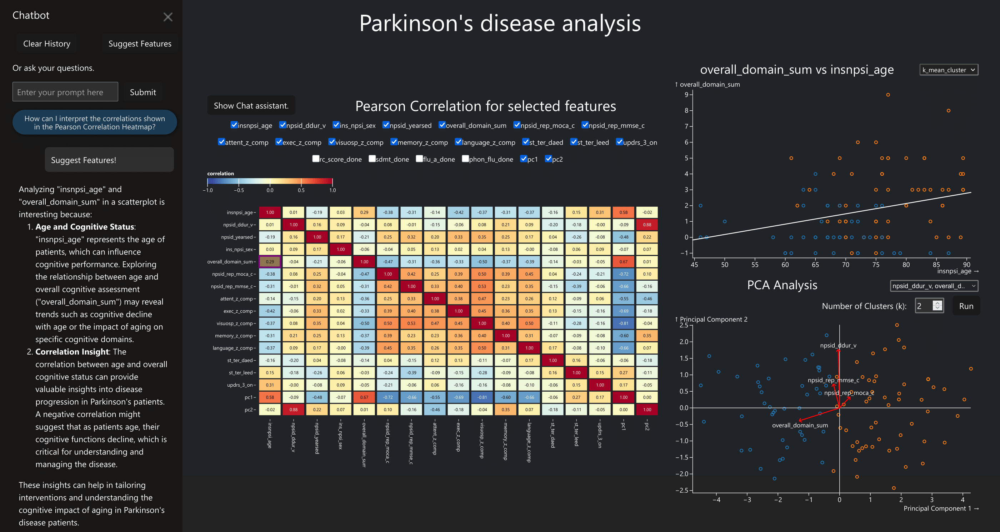

# Neurodegen-Vis

[](https://ceur-ws.org/Vol-4172/paper1.pdf)
[](https://doi.org/10.5281/zenodo.17870087)
[](LICENSE)

Welcome to Neurodegen-Vis, the code behind _Privacy-Preserving Visual Exploration of Healthcare Data with a Language Model Integration_, published in the Joint Proceedings of the [ECAI 2025](https://ecai2025.org/) Workshops XAI-KRKG and UCEX-XAI (CEUR-WS Vol-4172).

[Demo](https://hereditary.cgv.tugraz.at/neurodegen-vis/) · [Paper](https://ceur-ws.org/Vol-4172/paper1.pdf) · [TU Graz research portal](https://tugraz.elsevierpure.com/en/publications/privacy-preserving-visual-exploration-of-healthcare-data-with-a-l/)



> **Research use only. Not a medical device.** See [DISCLAIMER.md](DISCLAIMER.md) for intended use, data provenance and limitations.

## Overview

Neurodegen-Vis is a visual analytics tool for exploring correlations and dependencies in tabular patient data.
Instead of patient records, the dashboard shows synthetic data generated with differential privacy, and an integrated Large Language Model helps users interpret the data and navigate the dashboard.

### Key Features

- **Privacy-First Analytics:** The dashboard shows a synthetic table instead of the source cohort. Direct identifiers are removed, and the categorical columns and the correlation matrix are generated with differential privacy (MWEM, [OpenDP SmartNoise](https://github.com/opendp/smartnoise-sdk)). The continuous columns are sampled from fitted distributions whose parameters are not noised, so the formal guarantee covers only part of the table (see [DISCLAIMER.md](DISCLAIMER.md)).
- **Dataset:** The example dataset is derived from a Parkinson's disease cohort with demographic information, cognitive test results and treatment data.
- **LLM Assistance:** An integrated chatbot acts as a co-pilot to help users understand, explore, and analyze the dashboard and the underlying data:
  - **Context Awareness:** The model is aware of the dashboard's visualizations, interactions, feature descriptions, and correlation results.
  - **Automatically Updated Visualizations:** Interacting with the chatbot dynamically updates the UI. For example:
    - Highlighting specific heatmap cells and switching to the corresponding scatterplot when discussing correlation results.
    - Switching to the corresponding histogram view when asked about feature explanations or distributions.
  - **Exploration:** Using the _Suggest Features_ function proposes feature dependencies that could be interesting to analyze and automatically updates the scatterplot accordingly.

## Data

The source data is a project-internal Parkinson's disease cohort of the University of Padua; it is not published and not part of this repository.
The dashboard only ever loads the differentially private synthetic table (100 rows), which the frontend reads from `database/noisy.csv` under its base path.
It is not in the current tree, but is kept in the git history; to run the dashboard locally, restore it with

```bash
mkdir -p frontend/public/database
git show d3a0070:frontend/public/databases/noisy.csv > frontend/public/database/noisy.csv
```

## Running locally

If you just want to try the dashboard, use the [demo server](https://hereditary.cgv.tugraz.at/neurodegen-vis/).
To run it yourself:

1. Configure the language model in a `.env` file
2. Change the URL base path in `frontend/vite.config.ts`
3. Build and start the Docker containers

### 1. Configure the language model

Create a `.env` file in the repository root with an API key and the `SERVER` flag:

```
#.env
OPENAI_API_KEY=sk-proj-...
SERVER=false
```

With `SERVER=false` the backend sends chat requests to the OpenAI API (`gpt-4o-mini`), a provider outside the EU/EEA.
The demo server uses `SERVER=true`, which routes them to a self-hosted model at TU Graz instead.

### 2. Change the URL base path

In `frontend/vite.config.ts`, change

```ts
  // Deployment on Demo Server.
  base: "/neurodegen-vis",

  // // to run locally via Docker, uncomment the following line:
  // base: "./",
```

to

```ts
  // Deployment on Demo Server.
  // base: "/neurodegen-vis",

  // // to run locally via Docker, uncomment the following line:
  base: "./",
```

### 3. Build and start

```bash
docker compose up --build
```

## Citation

If you found this work helpful, please cite:

```bibtex
@inproceedings{2025-neurodegen-vis,
	booktitle = {Joint Proceedings of the ECAI 2025 Workshops XAI-KRKG and UCEX-XAI},
	series    = {CEUR Workshop Proceedings},
	volume    = {4172},
	title     = {{Privacy-Preserving Visual Exploration of Healthcare Data with a Language Model Integration}},
	author    = {Grabner, Michael and Waldert, Peter and Kantz, Benedikt and Schreck, Tobias},
	year      = {2025},
	pages     = {109--118},
	url       = {https://ceur-ws.org/Vol-4172/paper1.pdf}
}
```

## Acknowledgement

<picture>
  <source media="(prefers-color-scheme: dark)" srcset="figures/funded-by-the-eu-dark.png">
  
</picture>

Funded by the European Union under grant agreement No 101137074 ([HEREDITARY](https://hereditary-project.eu/)).
Views and opinions expressed are however those of the author(s) only and do not necessarily reflect those of the European Union or the European Health and Digital Executive Agency (HaDEA).
Neither the European Union nor the granting authority can be held responsible for them.

## License

MIT, see [LICENSE](LICENSE).
